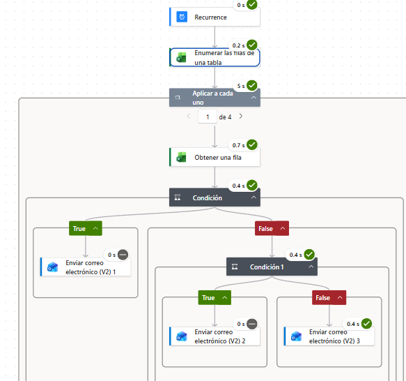

# Power Automate

# Evidencia de Automatización - Data Office Strategy

## 1. Contexto y Justificación del Negocio
La automatización de procesos operativos es un pilar fundamental dentro del diseño del Data Office. En el marco del proyecto, se identificó la necesidad de automatizar la revisión de las reservas hídricas para mitigar el riesgo de errores humanos y reducir los tiempos de respuesta ante desviaciones críticas[cite: 1, 2]. 

Esta tarea automatizada conecta los datos curados del proyecto con los canales de notificación del Comité de Riesgo Hídrico, asegurando la oportunidad y la calidad del dato exigida por el gobierno de datos[cite: 3].

## 2. Arquitectura y Funcionamiento del Flujo en Power Automate
El flujo implementado opera bajo la siguiente lógica técnica y de negocio:
1. **Origen de Datos (`reservas_alerta.xlsx`):** El flujo toma como insumo principal el archivo Excel ubicado en la carpeta, el cual contiene la información procesada y normalizada mediante el pipeline de Python.
2. **Disparador (*Trigger*):** Configurado para ejecutarse de manera periódica (programación diaria a las 6:30am) o ante modificaciones en los registros de umbrales críticos.
3. **Evaluación de Condiciones:** El motor evalúa de forma automatizada si los niveles hídricos sobrepasan los límites permitidos establecidos por las políticas del Data Office.
4. **Acción y Notificación:** En caso de cumplirse la condición de alerta, el sistema segmenta automáticamente a los destinatarios y despacha correos personalizados a los miembros del comité correspondientes.

## 3. Evidencia Visual del Flujo de Automatización
A continuación se muestra la estructura y los nodos configurados en Power Automate para la ejecución de este proceso:

> **Verificación de éxito:** El flujo se considera exitoso cuando los datos del Excel son leídos sin errores de sintaxis y los correos de notificación llegan de manera segmentada a los responsables asignados en el RACI del proyecto[cite: 3].