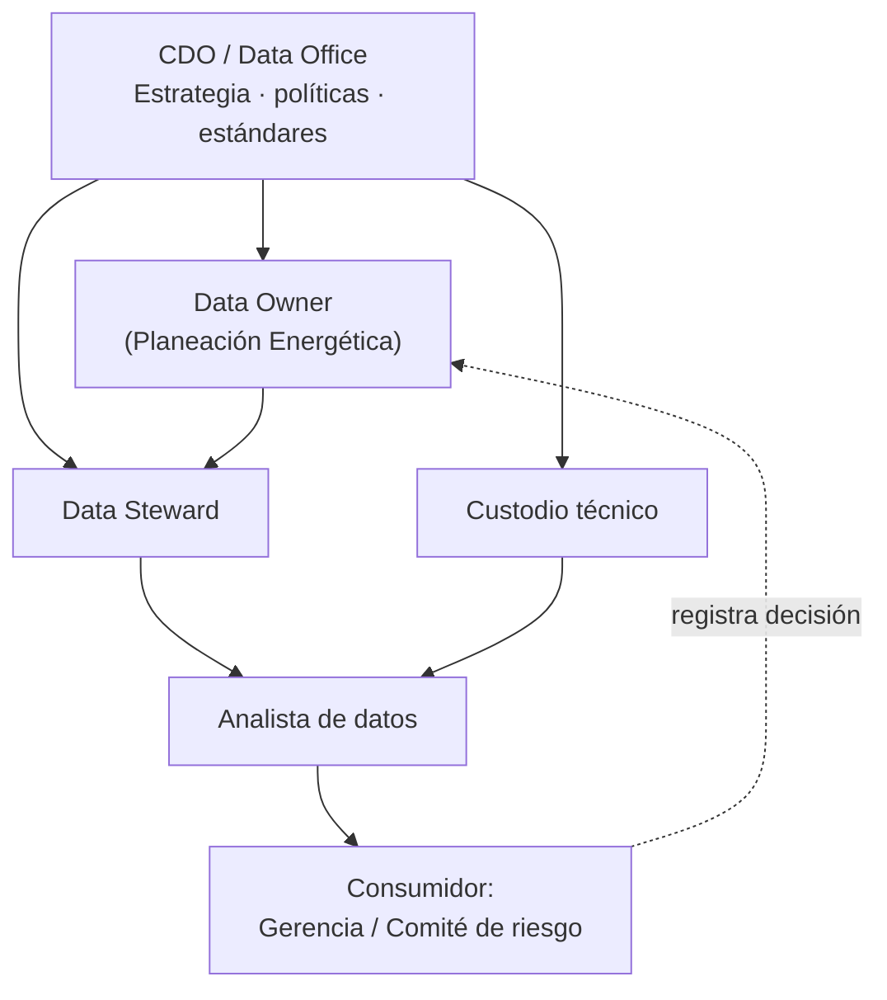

# 02 · Diseño del Data Office

**Solución:** HidroData SIN · **Versión:** v0.1.0 · **Rúbrica:** 1. Diseño organizacional (10 %) · alimenta 6. Gobierno (30 %)

---

## 1. Modelo propuesto: híbrido (federado)

Un **Data Office central**, liderado por el CDO, define políticas, estándares, reglas de calidad y arquitectura. La responsabilidad sobre el **significado y uso del dato** queda en el negocio, mediante un **Data Owner en Planeación Energética**.

### Alternativas evaluadas

| Modelo | Ventaja | Limitación | Ajuste |
|---|---|---|---|
| Centralizado | Estándares uniformes | Aleja las decisiones sobre el dato de quienes mejor lo entienden (Planeación Energética) | Medio |
| Descentralizado | Cercanía al negocio | No garantiza estándares únicos de calidad y clasificación, crítico si el dato alimenta decisiones de riesgo | Bajo |
| **Híbrido (federado)** | Equilibra control central y conocimiento del negocio; apto para una empresa mediana con un dominio principal (recurso hídrico y energético) | Requiere coordinación | **Alto** |

## 2. Estructura

## 3. Roles

| Rol | Responsabilidad principal |
|---|---|
| CDO / Data Office | Define estrategia, políticas y estándares; rinde cuentas ante la gerencia |
| Data Owner (Planeación Energética) | Dueño del significado del dato: aprueba clasificación, reglas de calidad y umbrales de riesgo |
| Data Steward | Aplica y monitorea reglas de calidad, mantiene catálogo y diccionario, resuelve incidentes |
| Custodio técnico | Opera infraestructura, pipeline y accesos |
| Analista de datos | Construye indicadores, EDA y dashboard |
| Consumidor (Gerencia / Comité de riesgo) | Usa dashboard y alertas para decidir y registra sus decisiones |

### Mapa del equipo *(ajustar con nombres reales)*

| Integrante | Roles asumidos |
|---|---|
| _[Integrante 1]_ | CDO · Data Owner (simulado) |
| _[Integrante 2]_ | Data Steward · Arquitecto de datos |
| _[Integrante 3]_ | Custodio técnico · Analista de datos |

## 4. Forma de trabajo

- El equipo técnico (analista y custodio) trabaja con enfoque **ágil**, en iteraciones de dos semanas alineadas con las entregas.
- El gobierno lo coordina el Data Office con revisiones periódicas junto al Data Owner.
- **Comité mensual** (CDO + Data Owner): aprueba políticas y criterios de riesgo.
- Ciclos de dos semanas: el custodio se encarga de la ingesta, el Steward revisa incidencias y definiciones, el analista prepara indicadores.
- Es la forma de trabajo prevista para HidroCol, no una estructura existente.

| Elemento | Definición |
|---|---|
| Tablero | GitHub Projects |
| Ramas | `main` · `develop` · `feat/…` con Pull Request |
| Definición de *Hecho* | Revisado por otro integrante, documentado y ejecutable |

## 5. Madurez de gobierno (diagnóstico inicial)

| Capacidad | Hoy (AS-IS) | Meta v1.0 |
|---|:---:|:---:|
| Estrategia de datos | 1 | 3 |
| Catálogo y metadatos | 1 | 3 |
| Calidad de datos | 1 | 3 |
| Roles y responsabilidades | 1 | 3 |
| Linaje y trazabilidad | 1 | 3 |
| Seguridad y privacidad | 2 | 3 |

*Escala 1 (ad hoc) a 5 (optimizado). Valores de diagnóstico propuestos para el caso hipotético.*

## 6. Matriz RACI

Ver [`Plan_Gobierno_Datos.md`](Plan_Gobierno_Datos.md#2-roles-y-responsabilidades-raci).
