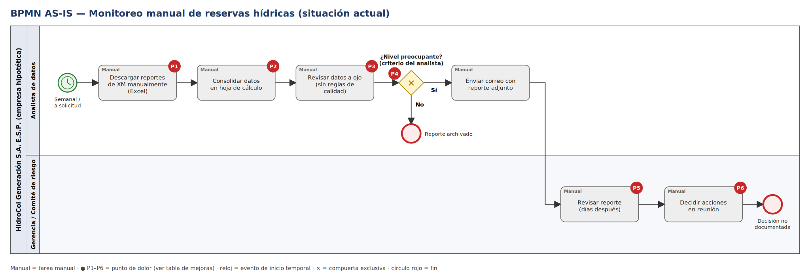
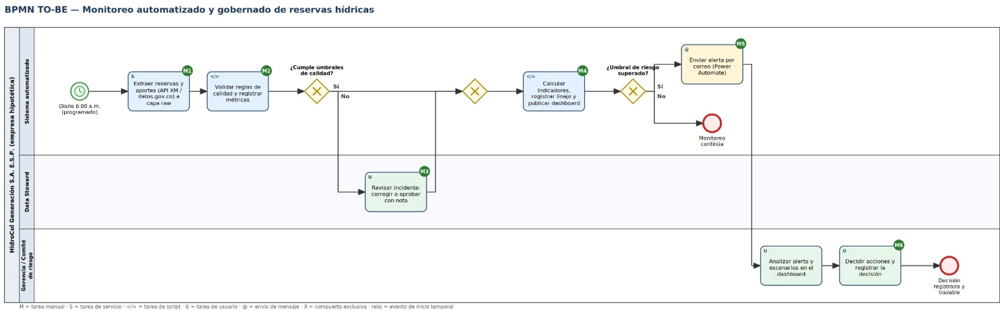

# 03 · Procesos (BPMN): situación actual y mejoras

**Solución:** HidroData SIN · **Versión:** v0.1.0 · **Rúbrica:** 2. Procesos (10 %) · enlaza con 3. Automatización (10 %)

---

## 1. Proceso AS-IS (situación actual)

*Figura 1. BPMN AS-IS — monitoreo manual de reservas hídricas. Marcadores P1–P6 = puntos de dolor.*

**Carriles:** Analista de datos · Gerencia / Comité de riesgo.

Hoy el monitoreo depende del analista. Una vez por semana, o cuando la gerencia lo pide, descarga los reportes de XM en Excel, los consolida en una hoja de cálculo y los revisa a ojo, sin reglas de calidad. Si según su criterio el nivel es preocupante, envía un correo con el reporte adjunto; si no, se archiva. La Gerencia y el Comité lo revisan días después y deciden en reunión, sin registrar la decisión ni los datos que la motivaron.

| Paso | Tarea | Tipo |
|---|---|---|
| 1 | Descargar reportes de XM manualmente (Excel) | Manual |
| 2 | Consolidar datos en hoja de cálculo | Manual |
| 3 | Revisar datos a ojo (sin reglas de calidad) | Manual |
| 4 | Compuerta: ¿nivel preocupante? (criterio del analista) | XOR |
| 5 | Enviar correo con reporte adjunto | Manual |
| 6 | Revisar reporte (días después) | Manual |
| 7 | Decidir acciones en reunión | Manual |
| Fin | Reporte archivado / decisión no documentada | — |

## 2. Puntos de dolor

| # | Punto de dolor |
|---|---|
| P1 | Descarga manual y periódica: el dato llega con retraso y depende de que alguien se acuerde |
| P2 | Consolidación en hoja de cálculo sin trazabilidad: no se sabe de dónde viene cada cifra ni qué se transformó |
| P3 | Revisión sin reglas de calidad: los errores pasan al reporte o se corrigen a mano sin registro |
| P4 | Criterio de riesgo subjetivo: sin umbrales definidos ni responsable que los apruebe |
| P5 | Revisión tardía: la gerencia ve el reporte días después |
| P6 | Decisión no documentada: no queda registro de qué se decidió ni con qué datos |

## 3. Proceso TO-BE

*Figura 2. BPMN TO-BE — monitoreo automatizado y gobernado de reservas hídricas.*

**Carriles:** Sistema automatizado · Data Steward · Gerencia / Comité de riesgo.

| Paso | Tarea | Tipo | Mejora |
|---|---|---|---|
| Inicio | Diario 6:00 a. m. (programado) | Evento temporal | M1 |
| 1 | Extraer reservas y aportes desde Sinergox / API de XM a capa raw | Servicio | M1 |
| 2 | Validar reglas de calidad y registrar métricas | Script | M2 |
| 3 | Compuerta: ¿cumple umbrales de calidad? No → Data Steward | XOR | M2 |
| 4 | Revisar incidente: corregir o aprobar con nota | Usuario | M3 |
| 5 | Calcular indicadores, registrar linaje y publicar dashboard | Script | M4 |
| 6 | Compuerta: ¿umbral de riesgo superado? No → monitoreo continúa | XOR | M5 |
| 7 | Enviar alerta por correo (Power Automate) | Mensaje | M5 |
| 8 | Analizar alerta y escenarios en el dashboard | Usuario | M6 |
| 9 | Decidir acciones y registrar la decisión | Usuario | M6 |
| Fin | Decisión registrada y trazable | — | O4 |

## 4. Mejoras M1–M6

| Mejora | AS-IS (problema) | TO-BE (solución) | Objetivo |
|---|---|---|---|
| **M1 · Ingesta programada** | Descarga manual semanal (P1) | Extracción automática diaria a las 6:00 a. m. desde Sinergox / API de XM a la capa raw | O1 |
| **M2 · Validación de calidad** | Revisión a ojo, sin reglas (P3) | Reglas automáticas y registro de métricas en cada ejecución | O3 |
| **M3 · Gestión de incidentes** | Errores sin detectar o corregidos sin registro (P3) | El Data Steward revisa cada incidente y lo corrige o aprueba con nota | O3 |
| **M4 · Indicadores y linaje** | Consolidación en Excel sin trazabilidad; revisión tardía (P2, P5) | Cálculo automático de indicadores, registro de linaje y publicación diaria del dashboard | O1, O4 |
| **M5 · Alerta automática** | Criterio subjetivo y correo manual (P4) | Umbral aprobado por el Data Owner y alerta por correo (Power Automate) | O2 |
| **M6 · Decisión registrada** | Decisión en reunión sin documentar (P6) | El comité analiza escenarios en el dashboard y registra su decisión de forma trazable | O4 |

### Trazabilidad dolor → mejora → objetivo

| Dolor | Mejora | Objetivo |
|---|---|---|
| P1 | M1 | O1 |
| P2 | M4 | O1, O4 |
| P3 | M2, M3 | O3 |
| P4 | M5 | O2 |
| P5 | M4 | O1 |
| P6 | M6 | O4 |

## 5. Tareas a automatizar (2.ª entrega)

| Tarea | Herramienta | Mejora |
|---|---|---|
| Ingesta diaria y validación automática | Script Python programado | M1, M2 |
| Alerta por correo al superar el umbral | Power Automate (Microsoft 365) | M5 |

## 6. Supuestos

- Las horas (6:00 a. m., 7:00 a. m.) y los umbrales son **metas de diseño** sujetas a validar la oportunidad real de publicación de Sinergox y a aprobación del Data Owner.
- HidroCol es hipotética: no hay medición del desempeño actual.
