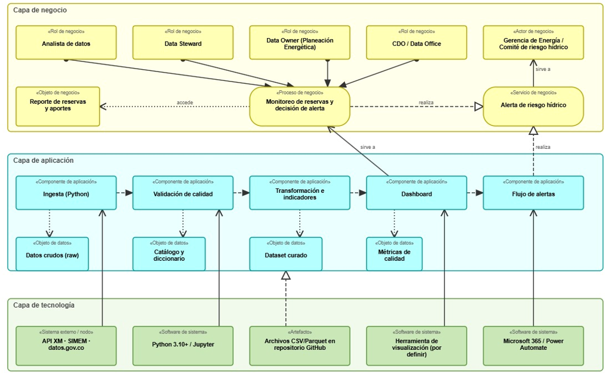
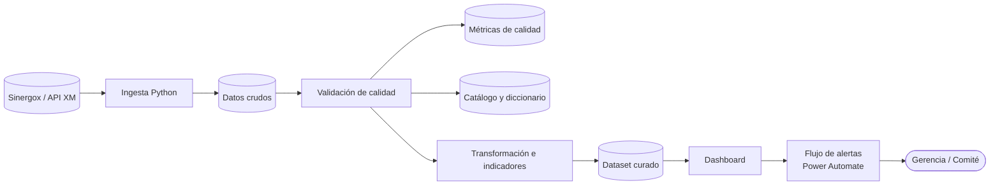

# 05 · Arquitectura de la solución (ArchiMate)

**Solución:** HidroData SIN · **Versión:** v0.1.0 (boceto E1) · **Rúbrica:** 4. Arquitectura de datos (10 %)

---

*Figura 3. ArchiMate (boceto E1) — negocio · aplicación · tecnología.*

## 1. Capa de negocio

| Tipo | Elemento | Descripción |
|---|---|---|
| Rol de negocio | Analista de datos | Construye indicadores y dashboard |
| Rol de negocio | Data Steward | Calidad, catálogo y diccionario |
| Rol de negocio | Data Owner (Planeación Energética) | Aprueba definiciones y umbrales |
| Rol de negocio | CDO / Data Office | Políticas y estándares |
| Actor de negocio | Gerencia de Energía / Comité de riesgo hídrico | Consume alertas y decide |
| Proceso de negocio | Monitoreo de reservas y decisión de alerta | Proceso TO-BE del [BPMN](03_procesos_bpmn.md) |
| Servicio de negocio | Alerta de riesgo hídrico | Lo que recibe la Gerencia |
| Objeto de negocio | Reporte de reservas y aportes | Información de negocio |

## 2. Capa de aplicación

| Tipo | Elemento | Datos que produce |
|---|---|---|
| Componente | Ingesta (Python) | Datos crudos (raw) |
| Componente | Validación de calidad | Catálogo y diccionario · Métricas de calidad |
| Componente | Transformación e indicadores | Dataset curado |
| Componente | Dashboard | — |
| Componente | Flujo de alertas | — |

Flujo de información: Ingesta → Validación → Transformación → Dashboard → Flujo de alertas.

## 3. Capa de tecnología

| Tipo | Elemento | Soporta a |
|---|---|---|
| Sistema externo / nodo | API de XM · **Sinergox** | Ingesta |
| Software de sistema | Python 3.10+ / Jupyter | Validación de calidad |
| Artefacto | Archivos CSV/Parquet en repositorio GitHub | Dataset curado |
| Software de sistema | Herramienta de visualización (por definir) | Dashboard |
| Software de sistema | Microsoft 365 / Power Automate | Flujo de alertas |

## 4. Relaciones principales

| Relación | Origen → Destino |
|---|---|
| Asignación | Roles (Analista, Steward, Data Owner, CDO) → Proceso de monitoreo |
| Realización | Proceso de monitoreo → Servicio de alerta de riesgo hídrico |
| Servicio | Servicio de alerta → Gerencia / Comité de riesgo |
| Servicio | Dashboard → Proceso de monitoreo |
| Realización | Flujo de alertas → Servicio de alerta |
| Acceso a datos | Proceso → Reporte; cada componente → su objeto de datos |
| Servicio (tecnología → aplicación) | Sinergox→Ingesta; Python→Validación; Visualización→Dashboard; Power Automate→Alertas |
| Realización | Artefacto CSV/Parquet → Dataset curado |

## 5. Vista de flujo de datos (apoyo)

## 6. Justificación

Se eligió una arquitectura por **capas de datos (raw → validado → curado)** porque separa el dato original del transformado. Esto permite reprocesar desde la fuente, medir la calidad en cada paso y reconstruir el linaje completo desde la fuente hasta el dashboard, requisito del modelo de gobierno. Las herramientas son gratuitas o de uso institucional (Python, GitHub, Microsoft 365), lo que hace la solución realista y reproducible **sin depender de una nube**.

| Decisión | Alternativa descartada | Razón |
|---|---|---|
| Capas raw → validado → curado | Transformar en el mismo dataset | Trazabilidad y reprocesamiento |
| Alerta con Power Automate | Envío manual de correo | Reduce el tiempo de alerta (O2) y el criterio subjetivo (P4) |
| Sin nube | Plataforma cloud | El curso no la exige; volumen pequeño |

## 7. Evolución

| Versión | Alcance |
|---|---|
| v0.1 (E1) | Boceto de las tres capas |
| v0.2 (E2) | Detalle de ingesta, catálogo y automatización |
| v1.0 (final) | Arquitectura alineada con la implementación real |
