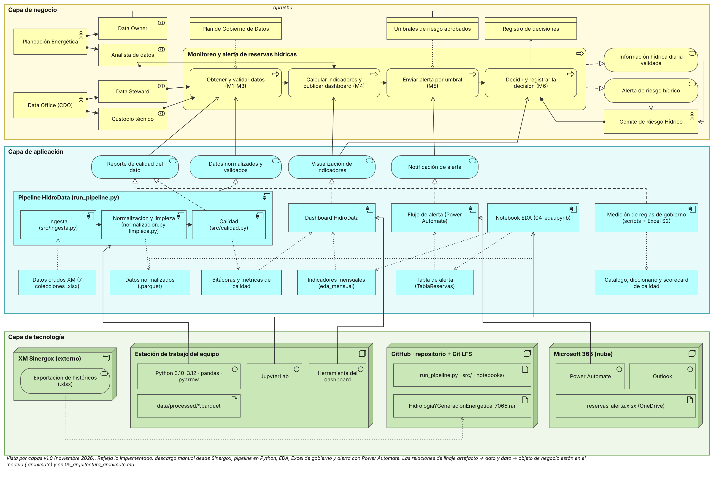

# 05 · Arquitectura de la solución (ArchiMate)

**Solución:** HidroData SIN · **Versión:** v1.0 (entrega final) · **Rúbrica:** 4. Arquitectura de datos (10 %)

La arquitectura v1.0 modela lo que está **implementado** en el repositorio, no lo previsto en el boceto de la primera entrega. Tiene tres capas conectadas: el proceso TO-BE del BPMN (negocio), los programas y datos del repositorio (aplicación) y dónde corren (tecnología).

*Figura 3. Vista por capas v1.0 de HidroData SIN. Modelo editable: [`HidroData_ArchiMate_v1.archimate`](../BPMNyArchiMate/HidroData_ArchiMate_v1.archimate) (se abre con [Archi](https://www.archimatetool.com/)). El boceto de la primera entrega se conserva en [`ArchiMate_Boceto_HidroData.png`](../BPMNyArchiMate/ArchiMate_Boceto_HidroData.png).*

## 1. Capa de negocio

| Tipo | Elemento | Papel en la solución |
|---|---|---|
| Actor | Planeación Energética | Spoke del Data Office federado; dueña del significado del dato y de los umbrales |
| Actor | Data Office (CDO) | Hub staff de la Gerencia General; políticas, estándares y calidad |
| Actor | Comité de Riesgo Hídrico | Decide ante una alerta y registra la decisión |
| Rol | Data Owner · Data Steward · Custodio técnico · Analista de datos | Los cuatro roles de la RACI (Plan de Gobierno §3) |
| Proceso | Monitoreo y alerta de reservas hídricas | Proceso TO-BE del [BPMN](03_procesos_bpmn.md), compuesto por los 4 subprocesos siguientes |
| Subproceso | Obtener y validar datos (M1–M3) | Descarga, reglas de calidad e incidentes |
| Subproceso | Calcular indicadores y publicar dashboard (M4) | Indicadores, linaje y dashboard |
| Subproceso | Enviar alerta por umbral (M5) | Correo automático con Power Automate |
| Subproceso | Decidir y registrar la decisión (M6) | Decisión del comité con constancia |
| Servicio | Información hídrica diaria validada · Alerta de riesgo hídrico | Lo que recibe el comité |
| Objeto | Plan de Gobierno de Datos · Umbrales de riesgo aprobados · Registro de decisiones | Información de negocio que gobierna y deja trazabilidad |

## 2. Capa de aplicación

| Tipo | Elemento | Archivo en el repositorio | Lee | Escribe |
|---|---|---|---|---|
| Componente | Ingesta | `src/ingesta.py` | Datos crudos XM | (parquet de ingesta) |
| Componente | Normalización y limpieza | `src/normalizacion.py`, `src/limpieza.py` | — | Datos normalizados |
| Componente | Calidad | `src/calidad.py` | — | Bitácoras y métricas de calidad |
| Componente | Pipeline HidroData | `run_pipeline.py` (orquesta los tres anteriores) | — | — |
| Componente | Notebook EDA | `notebooks/04_eda.ipynb` | Datos normalizados | Indicadores mensuales, Tabla de alerta |
| Componente | Dashboard HidroData | `dashboard/` | Indicadores mensuales, Bitácoras de calidad | — |
| Componente | Flujo de alerta | `automatizacion/` (Power Automate) | Tabla de alerta | — |
| Componente | Medición de reglas de gobierno | `documentacion/PlanDeGobierno/*.py` y Excel S2 | Datos crudos XM | Catálogo, diccionario y scorecard |
| Servicio | Datos normalizados y validados | Realizado por el pipeline; sirve a M1–M3 | | |
| Servicio | Reporte de calidad del dato | Realizado por Calidad y por la medición de reglas; sirve a M1–M3 | | |
| Servicio | Visualización de indicadores | Realizado por el dashboard; sirve a M4 y M6 | | |
| Servicio | Notificación de alerta | Realizado por el flujo de Power Automate; sirve a M5 | | |

## 3. Capa de tecnología

| Nodo | Contiene | Sirve a |
|---|---|---|
| XM Sinergox (externo) | Servicio de exportación de históricos (.xlsx) | Produce el `.rar` de datos crudos |
| Estación de trabajo del equipo | Python 3.10–3.12 con pandas y pyarrow · JupyterLab · herramienta del dashboard · `data/processed/*.parquet` | Pipeline, medición de reglas, EDA, dashboard |
| GitHub (repositorio + Git LFS) | Código (`run_pipeline.py`, `src/`, `notebooks/`) · `HidrologiaYGeneracionEnergetica_7065.rar` | Control de versiones y revisión por PR |
| Microsoft 365 (nube) | Power Automate · Outlook · `reservas_alerta.xlsx` en OneDrive | Flujo de alerta |

## 4. Trazabilidad entre capas (linaje de punta a punta)

Estas relaciones están en el modelo `.archimate`; algunas no se dibujan en la vista para no saturarla.

| De | Relación | A | Qué demuestra |
|---|---|---|---|
| Exportación de históricos (Sinergox) | acceso (escribe) | `.rar` en GitHub | Origen oficial del dato |
| `.rar` | realización | Datos crudos XM | El artefacto versionado es la fuente del pipeline |
| `data/processed/*.parquet` | realización | Datos normalizados | Salida reproducible con `python run_pipeline.py` |
| `reservas_alerta.xlsx` | realización | Tabla de alerta | El mismo archivo que genera el EDA lo lee el flujo |
| Tabla de alerta | realización | Umbrales de riesgo aprobados | Los umbrales del negocio quedan en columnas del dato |
| Catálogo, diccionario y scorecard | realización | Plan de Gobierno de Datos | El Plan se aplica sobre el dataset, no solo se describe |
| Visualización de indicadores | servicio | M4 y M6 | El comité decide con el dashboard |

Cadena completa: **Sinergox → `.rar` → Ingesta → Normalización y limpieza → Calidad → EDA → Indicadores / Tabla de alerta → Dashboard / Power Automate → Comité → Registro de decisiones**.

## 5. Justificación

| Decisión | Alternativa descartada | Razón |
|---|---|---|
| Capas de datos crudo → normalizado → indicadores, cada una en su archivo | Transformar sobre el mismo archivo | Se puede reprocesar desde la fuente y medir la calidad en cada paso (linaje del Plan §8) |
| Pipeline en scripts (`src/`) y análisis en notebooks | Todo en notebooks | Los scripts se ejecutan igual cada vez; el notebook queda para análisis y explicación |
| Descarga manual desde Sinergox, versionada en Git LFS | API de XM (`pydataxm`) | La descarga anual en Excel es la vía oficial verificada; el `.rar` versionado da evidencia de qué se descargó. La API queda como evolución (riesgo R1 de la estrategia) |
| Alerta con Power Automate sobre una tabla de Excel | Envío manual de correo | Reduce el tiempo de alerta (O2, K4) y elimina el criterio subjetivo (dolor P4) con herramientas ya licenciadas |
| Umbrales como columnas de la tabla de alerta | Umbrales escritos dentro del flujo | El Data Owner los cambia en un solo lugar y quedan trazables |
| Sin nube de datos | AWS, Azure o GCP | El curso no la exige y el volumen (≈ 2,1 millones de registros) cabe en una estación de trabajo |

## 6. Coherencia con las demás entregas

- **Estrategia:** los actores reflejan el organigrama to-be (Data Office federado: hub en la Gerencia General y spoke en Planeación Energética).
- **BPMN:** los cuatro subprocesos agrupan las mejoras M1–M6 del TO-BE.
- **Gobierno:** los roles son los de la RACI y los objetos de datos corresponden a los datasets del catálogo (DS-01 a DS-07 en Datos crudos XM).

## 7. Cambios frente al boceto v0.1

| v0.1 (boceto E1) | v1.0 | Motivo |
|---|---|---|
| Fuente «API XM · SIMEM · datos.gov.co» | XM Sinergox, exportación de históricos `.xlsx` | Es lo que se usó realmente |
| Componentes genéricos (validación, transformación) | Un componente por archivo de `src/` y notebook | Coherencia con el repositorio |
| «Métricas de calidad» colgando del dashboard | Las escribe Calidad; el dashboard las lee | Corrige la dirección del linaje |
| Sin Power Automate leyendo datos | Flujo lee `TablaReservas` de `reservas_alerta.xlsx` | Refleja la automatización entregada |
| Sin artefactos de gobierno | Medición de reglas y Excel S2 en el modelo | El gobierno se aplica sobre el dato |
| Proceso único | Proceso compuesto por M1–M6 en 4 subprocesos | Alineación con el BPMN TO-BE |

## 8. Cómo editar el modelo

La vista y el `.archimate` se generan con [`fuente/generar_archimate.py`](../BPMNyArchiMate/fuente/generar_archimate.py). Para cambiar un nombre o agregar un elemento se edita el script y se ejecuta `python documentacion/BPMNyArchiMate/fuente/generar_archimate.py` (el PNG necesita `playwright`). También se puede abrir el `.archimate` en Archi y editarlo a mano; en ese caso, exportar de nuevo la imagen desde Archi.
