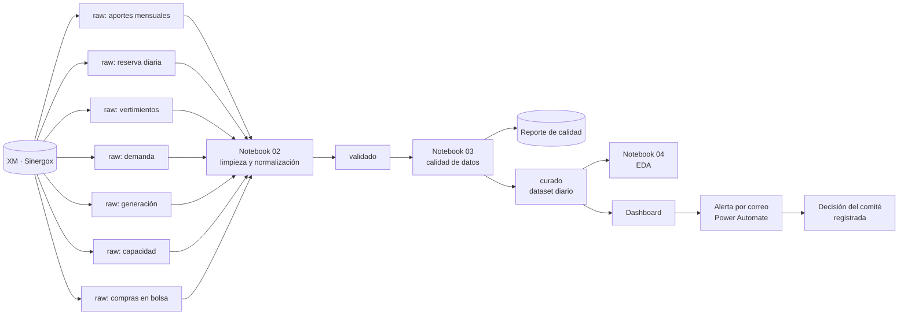

# Plan de Gobierno de Datos — HidroData SIN

**Versión:** 0.2.1 **Fecha:** 23 de octubre de 2026
**Caso:** HidroCol Generación S.A. E.S.P. 
**Fuente:** XM — Sinergox, 2022–2026
**Marco:** DAMA-DMBOK 2 · Ley 1581 de 2012 · Ley 1712 de 2014
**Equipo:** Sara Rúa García · Rafael José Gutiérrez Realpe · Valentina Leal Noreña · Paula Andrea Olier Alba

---

## 0. Qué cambió respecto a la v0.1

| Tema | v0.1 (primera entrega) | v0.2 (esta versión) |
|---|---|---|
| Datos | Variables descritas en abstracto, con unidades «por verificar» | Estructura real de las 7 tablas descargadas de Sinergox y hallazgos sobre ellas (sección 2) |
| Roles y RACI | Seis roles genéricos y siete actividades | Cuatro roles con responsables del equipo y la matriz RACI de siete tareas de gobierno (sección 3) |
| Catálogo | Inventario resumido | Inventario de 7 datasets: 2 con ficha completa de 17 campos y 5 con ficha resumida (sección 5) |
| Diccionario | Campos hipotéticos | 12 columnas documentadas por completo (Aportes y Reserva) y 5 tablas con diccionario preliminar (sección 6) |
| Glosario | No existía | 5 términos de negocio (sección 6.4) |
| Calidad | Reglas genéricas | 42 reglas medibles, varias derivadas de las filas de muestra (sección 7) |
| Madurez | Escala propuesta | Resultado de las dos autoevaluaciones del equipo (sección 12) |
| Estrategia | Sin vínculo explícito | Roles, comités, CDO, KPI y roadmap alineados con el documento de estrategia (secciones 1.1, 3.3, 13 y 14) |

## 1. Alcance, objetivos y dominios DAMA

**Alcance:** las 7 tablas de Sinergox 2022–2026 (aportes, reserva, vertimientos, demanda, generación, capacidad y compras en bolsa), el dataset curado diario que se derive de ellas, el reporte de calidad, el registro de linaje, los umbrales de alerta y el registro de decisiones del comité.

**Objetivos del gobierno:** (1) que cada campo tenga una definición única; (2) que la calidad se mida y no se suponga; (3) que cada cifra del dashboard se pueda rastrear hasta el archivo de origen; (4) que el uso del dato sea legal y quede claro quién puede ver o modificar qué; (5) que cada tarea tenga un responsable.

| Dominio DAMA | Dónde se aplica en este plan |
|---|---|
| Gobierno de datos | §3 Roles y RACI, §4 Políticas |
| Metadatos | §5 Catálogo, §6 Diccionario y glosario |
| Calidad de datos | §7 Reglas de calidad |
| Arquitectura e integración | §8 Linaje (ver [ArchiMate](05_arquitectura_archimate.md)) |
| Seguridad y privacidad | §9 Clasificación, §10 Control de acceso, §11 Cumplimiento |

### 1.1 Alineación con la estrategia corporativa

El plan es la parte de gobierno de la alternativa 4 elegida en la estrategia: visibilidad operativa, alerta temprana y gobernanza mediante un Data Office federado.

| Elemento de la estrategia | Cómo lo aplica este plan |
|---|---|
| Modelo federado (hub-and-spoke) | El hub es el Data Office (CDO, Data Steward y Custodio técnico) y el spoke es Planeación Energética, que ejerce el Data Owner (§3) |
| Objetivos O1 a O4 | Dashboard antes de las 7:00 a. m. (regla G-06), alerta en menos de 24 horas, calidad de 98 % o más (§7) y decisiones registradas (§10 y §13) |
| FODA cruzada DO1 y FA1 | La ingesta programada y la validación automática se vuelven reglas medibles (§7); el umbral aprobado por el Data Owner se vuelve política (§4.4 y §10) |
| FODA cruzada DO2 | El Data Office y el registro de decisiones se formalizan con roles, comités y clasificación (§3.3 y §9) |
| Debilidad «Planeación Energética desconectada del monitoreo» | Planeación Energética es el Data Owner y el analista pasa a esa área (§3.1) |
| Mapa estratégico (BSC) | Los artefactos del plan alimentan los objetivos A1, A2, P2, P3, P4 y C3 (§13) |

## 2. Los datos que tenemos y lo que encontramos

### 2.1 Inventario de tablas descargadas

| ID | Tabla (nombre en el archivo) | Grano (una fila por…) | Medidas principales | Unidad | Columnas |
|---|---|---|---|---|---|
| DS-01 | Aportes mensuales | río y mes | Aportes, media histórica, 95 % PSS, en energía y en caudal | kWh y m³/s | 10 |
| DS-02 | Histórico Reserva Diario SIN | día | Volumen útil diario | % | 2 |
| DS-03 | Histórico Vertimientos Diario | día y embalse (solo cuando hay vertimiento) | Vertimiento en volumen y en energía | miles de m³ y kWh | 5 |
| DS-04 | Demanda Energía SIN | día | Demanda, generación, demanda no atendida, exportaciones, importaciones | kWh | 6 |
| DS-05 | Generación (kW) 2022-2026 | día y recurso, con 24 columnas horarias | Generación por hora | kW | 6 + 24 horas + versión |
| DS-06 | Capacidad Efectiva Neta (kW) 2022-2026 | día y recurso | Capacidad efectiva neta | kW | 9 |
| DS-07 | Compras Bolsa Nacional (kWh) | día y agente, con 24 columnas horarias | Compras por hora | kWh | 2 + 24 horas + versión |

Los conteos y la estructura salen de las filas de muestra del archivo `Dataset_de_Sinergox_2022-2026`. Se confirman con los archivos completos al correr el notebook de ingesta.

### 2.2 Hallazgos que condicionan el gobierno

| ID | Hallazgo | Por qué importa | Qué hace el plan |
|---|---|---|---|
| H1 | Todos los números vienen en formato colombiano: punto para miles y coma para decimales (por ejemplo `148.486.400,00`). | Una lectura directa produce texto o valores mal escalados. | Regla G-01 y política de normalización (§4.1). |
| H2 | Las granularidades son mixtas: mensual (aportes), diaria (reserva, demanda, vertimientos), horaria (generación y compras) y diaria por recurso (capacidad). | No se pueden cruzar sin una granularidad común. | Granularidad objetivo diaria en la capa curada; reglas de agregación en §8.2. |
| H3 | **El archivo rotulado «Precio de la energía en bolsa» contiene «Compras Bolsa Nacional (kWh)» por agente y hora. Son cantidades de energía, no un precio en COP/kWh.** | Si se usa como precio, las conclusiones sobre el mercado serían erróneas. El precio de bolsa no está en el conjunto de datos actual. | Regla B-01; pendiente P3: descargar de Sinergox la serie de precio de bolsa (COP/kWh) o excluir el precio del alcance. |
| H4 | Generación y compras vienen en formato ancho (24 columnas, una por hora) y con una columna «Versión» (valor observado: `TX4`). | Hay que pasarlas a formato largo y decidir qué versión es la vigente. | Transformación T4 (§8.2) y regla GN-03. |
| H5 | Vertimientos solo trae filas en los días en que hubo vertimiento (en la muestra: 1 y 2 de enero, 16, 19 y 20). | La ausencia de un día no es un dato faltante; aplicar una regla de cobertura diaria daría falsos errores. | Regla V-04: confirmar con XM que «sin fila = sin vertimiento» y rellenar con 0 solo en la capa curada, con marca. |
| H6 | En la tabla de demanda hay celdas vacías en demanda no atendida, exportaciones e importaciones, y el balance cuadra al kWh en las 4 filas de muestra. | Las celdas vacías significan «no hubo», no «dato faltante». El balance sirve como regla de consistencia fuerte. | Reglas D-02 y D-03. |
| H7 | Las unidades no son homogéneas: kWh, kW, m³/s, miles de m³ y %. Generación y capacidad vienen en kW; demanda y aportes en kWh. | Sumar o comparar sin convertir produce errores de escala. | Sufijo de unidad en todos los nombres (§4.1); conversión documentada (kW por hora equivale a kWh de esa hora; por confirmar con XM). |
| H8 | Las tablas de generación y capacidad traen nombre del recurso y código de agente; la de compras trae código de agente. En la muestra hay recursos de autogeneración a pequeña escala cuyo nombre parece corresponder a una persona natural (por ejemplo, «AGPE ALVARO HOYOS»). | Podrían ser datos personales bajo la Ley 1581, aunque los publique XM. | Clasificación «Parcial» en §9 y regla de minimización: en la capa curada se agrega por tipo de generación y combustible. |
| H9 | Hay un valor negativo en compras (`-8,51`) y guiones «-» en celdas de generación y compras. | Un negativo en una cantidad de energía comprada no es un valor esperado, y un guion puede ser cero o dato ausente. | Reglas B-03 y GN-02; pendiente P6. |
| H10 | Los nombres de algunos ríos traen el prefijo «A.» (por ejemplo, «A. SAN LORENZO») y la lista completa de regiones hidrológicas aún no está extraída. | Afecta la unicidad y la lista de valores válidos. | Reglas A-04 y A-05; pendiente P1. |
| H11 | Las tablas se descargan por año («2022») y varios archivos; algunas fechas se ven como `#####` por el ancho de columna en el archivo. | Hay que consolidar archivos y leer las fechas del valor real, no del texto mostrado. | Política de ingesta (§4.2) y regla G-02. |
| H12 | La tabla de reserva trae solo el porcentaje del volumen útil (`Volumen Útil Diario %`). La Entrega 1 y el documento de estrategia hablan de «volumen útil en energía». | Cualquier cifra en GWh que cite la estrategia no sale de este archivo. | Todo el plan usa `pct_volumen_util_diario`; pendiente P13 para confirmar si hay una serie en energía. |

### 2.3 Dos verificaciones hechas sobre las filas de muestra

| Verificación | Resultado |
|---|---|
| Demanda = Generación + Importaciones − Exportaciones + Demanda no atendida (2022-01-01 a 2022-01-04) | Se cumple exactamente en las 4 filas (diferencia de 0,00 kWh). La aritmética indica que en las filas 1 y 2 el valor suelto es de exportaciones y la demanda no atendida está vacía. |
| Razón energía ÷ caudal por río, entre aportes, media histórica y 95 % PSS (3 ríos) | Varía entre 0,14 % y 0,63 % dentro de cada río (por ejemplo A. SAN LORENZO ≈ 7,0 millones de kWh por m³/s; CARLOS LLERAS ≈ 4,7 millones; CONCEPCIÓN ≈ 8,6 millones). Sirve como regla de consistencia (A-10). |
| 95 % PSS ≤ media histórica (3 ríos) | Se cumple en las 3 filas, en energía y en caudal. |
| Variación diaria de la reserva (5 primeros días) | Máxima de 0,54 puntos porcentuales entre días consecutivos. |
| Razón energía ÷ volumen de vertimientos (embalses AMANI y PLAYAS) | Constante por embalse (≈ 536,5 y ≈ 477,4 kWh por mil m³). Sirve como regla de consistencia (V-03). |

Son comprobaciones sobre muestras de 2 a 5 filas. Los porcentajes definitivos salen del notebook.

## 3. Roles y responsabilidades

### 3.1 Roles

El diseño organizacional de la estrategia (3.3) es lineal-staff con comités y doble línea funcional en los roles de datos. El Data Office es una unidad staff de la Gerencia General, con dos frentes. Los cargos de CDO, Data Steward y Custodio técnico son nuevos en HidroCol.

| Rol | Dónde está en HidroCol (empresa hipotética) | Quién lo ejerce en el equipo | Responsabilidad principal |
|---|---|---|---|
| **CDO** (líder de datos) | Data Office, staff de la Gerencia General; reporta al CEO | Sin integrante asignado | Define estrategia, políticas y estándares; preside el Comité de Gobierno de Datos |
| **Data Owner** | Jefatura de Planeación Energética (spoke del dominio hídrico) | Sara Rúa García | Decide las reglas, la calidad aceptable, los umbrales y el acceso |
| **Data Steward** | Data Office, frente Gobierno y Calidad | Rafael José Gutiérrez Realpe | Cuida el significado del dato y la calidad diaria |
| **Custodio técnico** | Data Office, frente Arquitectura e Ingeniería de Datos; coordina con la Gerencia de TI | Valentina Leal Noreña | Implementa y opera la infraestructura y el pipeline |
| **Consumidor / Analista** | Analista de datos (pasa a Planeación Energética, con línea funcional punteada al Data Office); Gerencia de Energía y Comité de Riesgo Hídrico como usuarios | Paula Andrea Olier Alba | Usa el dato, publica los productos y reporta problemas |
| *Gerencia de TI (apoyo)* | Gerencia de TI | — | Conserva la infraestructura y Microsoft 365; ejecuta los accesos aprobados |
| *Productor de la fuente (externo)* | XM S.A. E.S.P. | — | Publica los datos en Sinergox; HidroCol no lo gestiona |

**Criterio sobre el dueño del dato.** La estrategia (3.3) formaliza al Data Owner en la jefatura de Planeación Energética, que es el área que usa los datos y decide sobre su significado y sus umbrales. XM es el productor original: define cómo se publican, pero HidroCol no puede cambiar su contenido.

### 3.2 Matriz RACI de las tareas de gobierno

**R** = Responsable (ejecuta) · **A** = Accountable (rinde cuentas y aprueba; uno solo por fila) · **C** = Consultado · **I** = Informado

| Tarea de gobierno | Data Owner | Data Steward | Custodio técnico | Consumidor / Analista |
|---|:---:|:---:|:---:|:---:|
| Definir el catálogo y el diccionario de datos | **A** | **R** | C | C |
| Definir y medir las reglas de calidad del dato | **A** | **R** | C | C |
| Clasificar la sensibilidad del dato (datos personales / PII) | **A** | **R** | C | I |
| Definir el control de acceso (quién ve / modifica) | **A** | C | **R** | I |
| Mantener el linaje y la trazabilidad del dato | I | **A** | **R** | C |
| Aprobar la publicación del producto de datos | **A** | C | I | **R** |
| Documentar y actualizar el Plan de Gobierno de Datos | **A** | **R** | C | I |

Verificación: cada fila tiene un solo A y al menos un R.

### 3.3 Instancias de decisión y relación con la estrategia

La matriz de la sección 3.2 cubre las tareas de gobierno del dataset con cuatro roles. El CDO no es una columna porque no ejecuta esas tareas; su autoridad se ejerce en el comité que preside. Para que la matriz y la estrategia no se contradigan:

| Instancia | Quién la preside y quién participa | Qué decide sobre el dato |
|---|---|---|
| Comité de Gobierno de Datos (nuevo) | Preside el CDO; participan los Data Owners y TI | El CDO aprueba las políticas y estándares (§4). Las reglas de calidad y los umbrales los aprueba el Data Owner (RACI, §3.2) y el Comité los formaliza en acta |
| Comité de Riesgo Hídrico (existe y se formaliza) | Preside el Gerente de Energía; el CDO es invitado permanente | Decide sobre las alertas con umbral aprobado y registra cada decisión |

En la estrategia, el conflicto C1 entre el CDO y el Data Owner se maneja con esta división: el CDO aprueba políticas y el Data Owner aprueba clasificación, reglas y umbrales.

| Rol de la Entrega 1 y de la estrategia | En la matriz 3.2 |
|---|---|
| Data Owner (Planeación Energética) | Data Owner |
| Data Steward | Data Steward |
| Custodio técnico | Custodio técnico |
| Analista de datos, Gerencia de Energía y Comité de Riesgo Hídrico | Consumidor / Analista |
| CDO / Data Office | El Data Office opera por medio del Data Steward y el Custodio técnico; el CDO decide en el Comité de Gobierno de Datos |

Las actividades operativas de la Entrega 1 (operar la ingesta, resolver incidentes, definir umbrales de alerta y decidir ante una alerta) se mantienen con su matriz original.

## 4. Políticas y estándares

### 4.1 Nomenclatura

| Elemento | Estándar | Ejemplo |
|---|---|---|
| Columnas | `minusculas_con_guion_bajo`, sin tildes, con prefijo de tipo y sufijo de unidad | `cant_aportes_energia_kwh` |
| Prefijos | `fec_` fecha · `nom_` nombre o categoría · `cod_` código o identificador · `cant_` cantidad medida · `pct_` porcentaje · `ind_` indicador sí/no | `fec_reserva`, `pct_volumen_util_diario` |
| Sufijos de unidad | `_kwh`, `_kw`, `_m3s`, `_miles_m3`, `_pct` | `cant_capacidad_efectiva_neta_kw` |
| Fechas | ISO 8601 `AAAA-MM-DD` | `2022-01-01` |
| Meses | Se conserva el texto original (`fec_mes`) y se agrega `fec_mes_num` de 1 a 12 | `ENERO` → 1 |
| Números | Se convierten del formato colombiano a decimal con punto, sin separador de miles | `148.486.400,00` → `148486400.00` |
| Archivos | `dominio_contenido_periodo.extension` | `aportes_mensuales_2022_2026.csv` |
| Capas | `data/raw/`, `data/processed/validado/`, `data/processed/curado/` | — |
| Notebooks | Prefijo numérico en orden de ejecución | `03_calidad_datos.ipynb` |
| Versiones | SemVer | `v0.2.0` |

### 4.2 Ingesta y conservación

| Tema | Política |
|---|---|
| Archivos originales | Se guardan sin modificar en `data/raw/`, con su nombre de origen |
| Manifiesto de descarga | Por cada archivo: nombre, tabla, URL de Sinergox, fecha y hora de descarga, responsable y hash SHA-256 |
| Capas | `raw` inmutable → `validado` (pasa las reglas) → `curado` (integrado, diario) |
| Reproducibilidad | `validado` y `curado` se pueden regenerar desde `raw` con el pipeline |
| Versiones de la fuente | Si XM actualiza valores ya publicados, se descarga de nuevo, se guarda con nueva fecha y no se sobrescribe |
| Retención | `raw`: permanente durante el proyecto. Reportes de calidad y linaje: historial completo. Registro de alertas y decisiones: permanente. Logs de automatización: 90 días *(propuesta; la aprueba el Data Owner)* |

### 4.3 Uso aceptable

1. El dato se usa para monitoreo, análisis y decisiones de riesgo hídrico de HidroCol.
2. Se cita siempre a XM — Sinergox como fuente.
3. No se modifican los archivos de `data/raw/`.
4. Las alertas oficiales solo se emiten con umbrales aprobados por el Data Owner.
5. Cada decisión del comité se registra con los datos y la versión del dashboard que la motivaron.
6. No se intenta identificar personas a partir de los nombres de recursos o agentes.
7. Las condiciones de licencia de Sinergox están por confirmar; hasta entonces el uso es interno y con atribución (pendiente P7).

### 4.4 Gestión de cambios

Todo cambio al esquema, las reglas de calidad, los umbrales o el diccionario se hace por Pull Request con revisión de otro integrante y se registra en `CHANGELOG.md`. El Data Owner aprueba los cambios de reglas y umbrales, y el Comité de Gobierno de Datos los formaliza en acta. Las políticas y estándares de esta sección los aprueba el CDO en ese mismo comité.

### 4.5 Gestión de incidentes de calidad

| Paso | Qué ocurre | Quién |
|---|---|---|
| 1. Detectar | El notebook de calidad marca la regla incumplida y su severidad | Custodio técnico |
| 2. Registrar | Se abre un Issue en GitHub con la etiqueta `calidad`, la regla, el dataset y la evidencia | Custodio técnico |
| 3. Revisar | El Steward analiza la causa en 2 días hábiles o menos | Data Steward |
| 4. Resolver | Se corrige en el pipeline o se aprueba el dato con una nota que explica por qué | Data Steward (aprueba el Data Owner si afecta una regla) |
| 5. Cerrar | Se documenta la decisión y se vuelve a medir | Data Steward |

## 5. Catálogo de datos

### 5.1 Inventario de activos

| ID | Activo | Descripción corta | Fuente | Frecuencia | Cobertura | Clasificación | Ficha |
|---|---|---|---|---|---|---|---|
| DS-01 | Aportes hídricos mensuales por río del SIN | Agua que llega a los embalses, con su media histórica y su referencia seca | Sinergox · Hidrología › Histórico | Mensual | 2022 a 2026 | Pública | Completa (17 de 17) |
| DS-02 | Reserva útil diaria del SIN (%) | Porcentaje del volumen útil de los embalses, indicador central | Sinergox · Hidrología › Histórico | Diaria | 01/01/2022 a 2026 | Pública | Completa (17 de 17) |
| DS-03 | Vertimientos diarios por embalse | Agua liberada sin generar energía | Sinergox · Hidrología › Histórico | Por evento | 2022 a 2026 | Pública | Resumida |
| DS-04 | Demanda de energía del SIN | Demanda, generación, demanda no atendida, exportaciones e importaciones | Sinergox · Demanda › Histórico | Diaria | 2022 a 2026 | Pública | Resumida |
| DS-05 | Generación real por recurso y hora | Generación horaria por planta o recurso | Sinergox · Oferta › Histórico | Horaria | 2022 a 2026 | Pública; PII parcial por revisar | Resumida |
| DS-06 | Capacidad efectiva neta por recurso | Potencia disponible por recurso | Sinergox · Oferta › Histórico | Diaria | 2022 a 2026 | Pública; PII parcial por revisar | Resumida |
| DS-07 | Compras en bolsa nacional por agente y hora | Energía comprada en bolsa (no es precio) | Sinergox · Transacciones › Histórico | Horaria | 2022 a 2026 | Pública | Resumida |
| DS-08 | Dataset curado diario | Integración de las tablas a granularidad diaria con indicadores | Derivado | Diaria | 2022 a 2026 | Pública | Por crear |
| DS-09 | Reporte de calidad | Resultado de las reglas por ejecución | Derivado | Por ejecución | Por ejecución | Uso interno | Por crear |
| DS-10 | Registro de linaje | Traza de cada transformación por ejecución | Derivado | Por ejecución | Por ejecución | Uso interno | Por crear |

URL de las fuentes: `https://sinergox.xm.com.co/hydrology/historical` (DS-01 a DS-03), `https://sinergox.xm.com.co/demand/historical` (DS-04), `https://sinergox.xm.com.co/supply/historical` (DS-05 y DS-06) y `https://sinergox.xm.com.co/transactions/historical` (DS-07).

### 5.2 Fichas completas (DS-01 y DS-02)

| Campo | DS-01 · Tabla principal | DS-02 · Tabla complementaria |
|---|---|---|
| Nombre del dataset | Aportes hídricos mensuales por río del SIN | Reserva útil diaria del SIN (%) |
| Descripción | Una fila por río y mes con los aportes que llegaron (en caudal m³/s y en energía equivalente kWh), su media histórica y su referencia de hidrología seca (95 % PSS). Sirve para saber si está llegando más o menos agua de lo normal y anticipar la caída de las reservas (alerta temprana de riesgo hídrico). | Una fila por día con el porcentaje de volumen útil de los embalses del SIN. Es el indicador central del caso: muestra cuánta energía almacenada queda y cómo varía día a día. |
| Organización / proceso | HidroCol Generación S.A. E.S.P. (empresa hipotética) · monitoreo y gestión del riesgo hídrico | Igual |
| Data Owner | Gerencia de Planeación Energética (HidroCol) | Igual |
| Data Steward | Data Steward · Data Office HidroCol | Igual |
| Custodio técnico | Equipo de datos (pipeline Python y repositorio GitHub) | Igual |
| Fuente / sistema de origen | XM S.A. E.S.P. · Sinergox, Hidrología › Histórico › Aportes · https://sinergox.xm.com.co/hydrology/historical | XM S.A. E.S.P. · Sinergox, Hidrología › Histórico › Reservas · https://sinergox.xm.com.co/hydrology/historical/Reservas |
| Ubicación | Descarga de Sinergox guardada por el equipo; destino: repositorio GitHub, capa `raw` (ruta exacta por confirmar) | Igual |
| Formato | Archivo tabular descargado de Sinergox (Excel). Números con formato colombiano: punto = miles, coma = decimales | Igual |
| Frecuencia de actualización | Mensual | Diaria |
| Fecha de última actualización | 28/09/2026 (fecha de descarga) | 28/09/2026 (fecha de descarga) |
| Periodo y cobertura | Enero 2022 a 2026 (último mes publicado) · ríos aportantes del SIN agrupados por región hidrológica | 01/01/2022 a 2026 (último día publicado) · total del SIN (agregado nacional, sin detalle por embalse) |
| N.º de registros / columnas | Variable: varios archivos descargados con distinto número de filas; no se reporta un total único · 10 columnas | Variable: varios archivos con distinto número de filas (≈1 por día) · 2 columnas |
| Clasificación de sensibilidad | Pública | Pública |
| ¿Contiene datos personales? | No | No |
| Condiciones de uso / licencia | Información pública publicada por XM; uso interno de HidroCol para análisis y reportes, citando a XM. Licencia exacta: desconocida (revisar términos de uso de Sinergox) | Igual |
| Contacto para dudas | gobiernodatos@hidrocol.com.co (buzón propuesto del Data Office; empresa hipotética) | Igual |

El número exacto de registros se completa cuando el notebook de ingesta consolide los archivos.

### 5.3 Fichas resumidas (DS-03 a DS-07)

Se completan los 17 campos en la versión final. Los campos comunes son: organización y proceso (HidroCol, monitoreo del riesgo hídrico), Data Owner (Gerencia de Planeación Energética), Data Steward (Data Office), Custodio técnico (equipo de datos), formato (Excel de Sinergox con formato numérico colombiano), fecha de descarga (28/09/2026), licencia (desconocida) y contacto (buzón del Data Office).

| Dataset | Descripción | Grano | Frecuencia | Datos personales |
|---|---|---|---|---|
| DS-03 Vertimientos | Agua que pasa por un embalse sin generar energía, en volumen y en energía equivalente | Día y embalse, solo cuando hay vertimiento | Por evento | No |
| DS-04 Demanda | Demanda del sistema y su balance contra generación, importaciones, exportaciones y demanda no atendida | Día | Diaria | No |
| DS-05 Generación | Energía generada por cada recurso, hora a hora, con la versión de liquidación | Día y recurso (24 horas) | Horaria | Parcial: nombre de recurso y código de agente |
| DS-06 Capacidad | Capacidad efectiva neta de cada recurso, con su tipo, combustible y clasificación | Día y recurso | Diaria | Parcial: nombre de recurso y código de agente |
| DS-07 Compras en bolsa | Energía comprada por cada agente en la bolsa nacional, hora a hora, con la versión | Día y agente (24 horas) | Horaria | No; revisar el código de agente |

## 6. Diccionario de datos y glosario

### 6.1 Diccionario completo: Aportes mensuales (DS-01) y Reserva diaria (DS-02)

Los nombres estándar siguen la política de §4.1. Ninguna columna admite vacíos. Todas son de sensibilidad **Pública**. El responsable de cada una es el Data Steward · Data Office HidroCol. Los códigos de la última columna remiten a las reglas de la sección 7.

| # | Nombre de origen → estándar | Descripción | Tipo · formato o unidad | Valores permitidos | Ejemplo | Reglas |
|---|---|---|---|---|---|---|
| 1 | Año → `fec_anio` | Año calendario al que corresponden los aportes del registro. Junto con el mes identifica el periodo. | Entero · AAAA | 2022 a 2026 | 2022 | A-03 |
| 2 | Mes → `fec_mes` | Mes calendario en letras y mayúsculas. Para ordenar o graficar se convierte a número (ENERO = 1 … DICIEMBRE = 12). | Categoría · texto en mayúsculas | Los 12 meses en español | ENERO | A-03 |
| 3 | Region Hidrologica → `nom_region_hidrologica` | Zona geográfica en la que XM agrupa los ríos que alimentan los embalses del SIN. Permite ver en qué parte del país llega más o menos agua. | Categoría · mayúsculas sin tildes | Lista cerrada de XM (por ejemplo ANTIOQUIA, CENTRO); lista completa por extraer | ANTIOQUIA | A-04 |
| 4 | Nombre Río → `nom_rio` | Río o cuenca cuyo caudal se mide como aporte al sistema, tal como lo nombra XM. Algunos traen prefijo abreviado («A. SAN LORENZO»), cuyo significado está por confirmar. | Texto · mayúsculas | Nombres publicados por XM | CARLOS LLERAS | A-02, A-05 |
| 5 | Aportes Energía kWh → `cant_aportes_energia_kwh` | Agua que llegó por el río en el mes, convertida a la energía que podría generar en las plantas aguas abajo. Total acumulado del mes. Base para comparar contra la media histórica. | Decimal · kWh, 2 decimales (origen `148.486.400,00`) | ≥ 0 | 148.486.400,00 | G-01, A-01, A-06, A-07, A-10 |
| 6 | Aportes Caudal m3/s → `cant_aportes_caudal_m3s` | Caudal promedio del río durante el mes: metros cúbicos de agua por segundo. | Decimal · m³/s, 2 decimales | ≥ 0 | 21,17 | G-01, A-06, A-07, A-10 |
| 7 | Aportes Media Histórica Energía kWh → `cant_media_hist_energia_kwh` | Aporte promedio que ese río ha tenido en ese mismo mes a lo largo de los años, calculado por XM. Es «lo normal»: aportes ÷ media × 100 da el porcentaje de la media. | Decimal · kWh, 2 decimales | > 0 | 168.640.000,00 | A-06, A-08, A-09, A-10 |
| 8 | Aportes Media Histórica Caudal m3/s → `cant_media_hist_caudal_m3s` | Caudal promedio que ese río ha tenido en ese mismo mes a lo largo de los años, según XM. Referencia de normalidad en m³/s. | Decimal · m³/s, 2 decimales | > 0 | 24,01 | A-06, A-08, A-09, A-10 |
| 9 | Aportes 95 PSS Energía kWh → `cant_aportes_95pss_energia_kwh` | Aporte en energía que el río supera el 95 % de las veces (PSS = probabilidad de ser superado). Es el escenario seco de referencia: un mes por debajo es excepcionalmente seco. | Decimal · kWh, 2 decimales | ≥ 0 y ≤ la media histórica en energía del mismo río y mes | 89.900.000,00 | A-08, A-10 |
| 10 | Aportes 95 PSS Caudal m3/s → `cant_aportes_95pss_caudal_m3s` | Caudal que el río supera el 95 % de las veces en ese mes; escenario seco de referencia en m³/s. | Decimal · m³/s, 2 decimales | ≥ 0 y ≤ la media histórica en caudal del mismo río y mes | 12,81 | A-08, A-10 |
| 11 | Fecha → `fec_reserva` | Día al que corresponde el nivel de reserva del SIN publicado por XM. | Fecha · AAAA-MM-DD | Desde 01/01/2022 hasta la fecha de descarga | 2022-01-01 | R-02, R-03, R-06 |
| 12 | Volumen Útil Diario % → `pct_volumen_util_diario` | Porcentaje de la capacidad útil de los embalses del SIN que está llena ese día, en términos de energía. Es el indicador principal del tablero: si baja de forma sostenida, crece el riesgo de racionamiento. | Decimal · % en escala 0–100, 2 decimales | 0 a 100 | 79,06 | R-01, R-04, R-05 |

### 6.2 Diccionario preliminar de las otras cinco tablas

> Preliminar: sale de los encabezados y las filas de muestra. Los tipos y rangos se confirman con los archivos completos y con XM.

**DS-03 Vertimientos**

| Origen → estándar | Descripción | Tipo · unidad | Reglas |
|---|---|---|---|
| Fecha → `fec_vertimiento` | Día en que se registró el vertimiento | Fecha · AAAA-MM-DD | G-02, V-01 |
| Region Hidrologica → `nom_region_hidrologica` | Región a la que pertenece el embalse | Categoría | V-02, V-05 |
| Nombre Embalse → `nom_embalse` | Embalse donde hubo vertimiento | Texto · mayúsculas | V-01, V-05 |
| Vertimientos Volumen miles m3 → `cant_vertimientos_volumen_miles_m3` | Volumen de agua vertida | Decimal · miles de m³ | G-01, V-02, V-03 |
| Vertimientos Energía kWh → `cant_vertimientos_energia_kwh` | Energía equivalente al agua vertida | Decimal · kWh | G-01, V-02, V-03 |

**DS-04 Demanda**

| Origen → estándar | Descripción | Tipo · unidad | Reglas |
|---|---|---|---|
| Fecha → `fec_demanda` | Día | Fecha · AAAA-MM-DD | G-02, D-01, D-04 |
| Demanda Energia SIN kWh → `cant_demanda_energia_sin_kwh` | Energía que demandó el sistema en el día | Decimal · kWh | G-01, D-02, D-03 |
| Generación kWh → `cant_generacion_sin_kwh` | Energía generada en el día | Decimal · kWh | G-01, D-02, D-03 |
| Demanda No Atendida kWh → `cant_demanda_no_atendida_kwh` | Demanda que no se pudo atender; vacío significa que no hubo | Decimal · kWh | D-02, D-03 |
| Exportaciones kWh → `cant_exportaciones_kwh` | Energía exportada; vacío significa que no hubo | Decimal · kWh | D-02, D-03 |
| Importaciones kWh → `cant_importaciones_kwh` | Energía importada; vacío significa que no hubo | Decimal · kWh | D-02, D-03 |

**DS-05 Generación**

| Origen → estándar | Descripción | Tipo · unidad | Reglas |
|---|---|---|---|
| Fecha → `fec_generacion` | Día | Fecha · AAAA-MM-DD | G-02, GN-03 |
| Recurso → `nom_recurso` | Planta o recurso que genera | Texto | GN-03 |
| Tipo Generación → `nom_tipo_generacion` | Tecnología (por ejemplo hidráulica, térmica, solar) | Categoría | GN-02 |
| Combustible → `nom_combustible` | Combustible o recurso primario (por ejemplo agua, gas, radiación solar) | Categoría | GN-02 |
| Código Agente → `cod_agente` | Identificador del agente dueño del recurso | Código | GN-03 |
| Tipo Despacho → `nom_tipo_despacho` | Si el recurso se despacha centralmente o no | Categoría | GN-02 |
| 0 … 23 → `fec_hora` + `cant_generacion_kw` | Generación de cada hora; se pasa a formato largo | Decimal · kW | G-01, GN-01, GN-02, GN-04 |
| Versión → `nom_version` | Versión de la liquidación (observada: `TX4`) | Código | GN-03 |

**DS-06 Capacidad**

| Origen → estándar | Descripción | Tipo · unidad | Reglas |
|---|---|---|---|
| Fecha → `fec_capacidad` | Día | Fecha · AAAA-MM-DD | G-02, CP-03 |
| Recurso → `nom_recurso` | Planta o recurso | Texto | CP-03 |
| Código Agente → `cod_agente` | Identificador del agente | Código | CP-03 |
| Tipo de Generación → `nom_tipo_generacion` | Tecnología | Categoría | CP-02 |
| Combustible por defecto → `nom_combustible` | Combustible o recurso primario | Categoría | CP-02 |
| Tipo de Despacho → `nom_tipo_despacho` | Despacho central o no | Categoría | CP-02 |
| Es Menor → `ind_es_menor` | Si es planta menor (SI / NO) | Indicador | CP-02 |
| Clasificación → `nom_clasificacion` | Clasificación del recurso (por ejemplo autogenerador a pequeña escala) | Categoría | CP-02 |
| Capacidad Efectiva Neta kW → `cant_capacidad_efectiva_neta_kw` | Potencia máxima disponible del recurso | Decimal · kW | G-01, CP-01, CP-02, CP-04 |

**DS-07 Compras en bolsa**

| Origen → estándar | Descripción | Tipo · unidad | Reglas |
|---|---|---|---|
| Fecha → `fec_compra` | Día | Fecha · AAAA-MM-DD | G-02, B-02 |
| Código Agente → `cod_agente` | Agente comprador | Código | B-02 |
| 0 … 23 → `fec_hora` + `cant_compras_kwh` | Energía comprada en cada hora; formato largo | Decimal · kWh | G-01, B-01, B-03 |
| Versión → `nom_version` | Versión de la liquidación (observada: `TX4`) | Código | B-02 |

### 6.3 Dataset curado (DS-08): campos previstos

`fec_dia` · `pct_volumen_util_diario` · `cant_aportes_energia_kwh` (diaria, prorrateada de la mensual y marcada como tal) · `pct_aportes_vs_media` · `cant_vertimientos_energia_kwh` · `cant_demanda_energia_sin_kwh` · `cant_generacion_sin_kwh` · `cant_generacion_hidraulica_kwh` · `cant_capacidad_efectiva_neta_kw` · `ind_dia_parcial` · `ind_estado_riesgo` · `fec_carga`. La fórmula del umbral de riesgo la aprueba el Data Owner (pendiente P5).

### 6.4 Glosario de negocio

| Término | Definición de negocio | También llamado | Columnas relacionadas | Aprueba |
|---|---|---|---|---|
| Aportes hídricos | Agua que llega de los ríos a los embalses y plantas del sistema en un periodo, expresada en caudal o en la energía que permite generar. Indica lo que está entrando, no lo que hay guardado. | Aportes, caudales, afluencias | `cant_aportes_energia_kwh`, `cant_aportes_caudal_m3s` | Gerencia de Planeación Energética |
| Reserva útil | Parte del agua embalsada que sí se puede usar para generar, como porcentaje de la capacidad útil de todos los embalses del país. No incluye el agua por debajo del nivel mínimo de operación. | Volumen útil, nivel de embalses, reservas hídricas, energía almacenada | `pct_volumen_util_diario` | Gerencia de Planeación Energética |
| Aportes frente a la media histórica | Comparación entre lo que llegó en un mes y lo que normalmente llega ese mismo mes. Por debajo de 100 % es un periodo más seco de lo normal; por encima, más húmedo. | % de la media, hidrología relativa | `cant_aportes_energia_kwh` ÷ `cant_media_hist_energia_kwh` | Gerencia de Planeación Energética |
| Hidrología seca (escenario 95 % PSS) | Nivel de aportes tan bajo que solo no se alcanza en 5 de cada 100 casos. Referencia de escenario crítico, por ejemplo durante El Niño. | Año seco, condición crítica, 95 % PSS | `cant_aportes_95pss_energia_kwh`, `cant_aportes_95pss_caudal_m3s` | Gerencia de Planeación Energética |
| Situación de riesgo hídrico | Momento en que la reserva útil o los aportes cruzan el umbral aprobado por la empresa y el comité debe revisar y registrar una decisión. El valor del umbral lo fija el Data Owner; hasta que lo apruebe no hay alerta oficial. | Alerta hídrica, riesgo de racionamiento, alerta temprana | `pct_volumen_util_diario`, aportes frente a la media | Gerencia de Planeación Energética |

## 7. Reglas de calidad

Cada regla se mide en el notebook de calidad y produce un porcentaje de cumplimiento por dataset. El índice de calidad global es el promedio ponderado por severidad (meta: 98 % o más, indicador O3).

**Severidad y tratamiento:** **Alta** detiene el pipeline y pasa al Steward (§4.5). **Media** deja continuar, marca el registro y lo reporta. **Baja** se registra en el reporte. Esta regla responde al conflicto C2 de la estrategia (calidad frente a la publicación antes de las 7:00 a. m.): lo acuerda el Data Owner y la media publica con marca de advertencia.

### 7.1 Reglas generales

| ID | Dimensión | Regla | Métrica | Umbral | Sev. | Resultado |
|---|---|---|---|---|:---:|:---:|
| G-01 | Validez | Todo valor numérico se convierte del formato colombiano sin errores | % de valores convertidos | 100 % | Alta | Por medir |
| G-02 | Validez | Las fechas son ISO 8601, existen y no son futuras | % de fechas válidas | 100 % | Alta | Por medir |
| G-03 | Unicidad | Ninguna fila duplicada por la clave natural de cada dataset | % de duplicados | 0 % | Alta | Por medir |
| G-04 | Completitud | Cada archivo de `raw` tiene su fila en el manifiesto de descarga con hash | % de archivos con manifiesto | 100 % | Media | Por medir |
| G-05 | Oportunidad | Rezago entre la fecha de descarga y la última fecha publicada | Días de rezago | Diarios: 2 días o menos *(tentativo, se fija al medir)*. Mensual: mes anterior ya publicado | Media | Por medir |
| G-06 | Oportunidad | La capa curada del día está disponible antes de las 7:00 a. m. (KPI K1, objetivo O1) | % de días con la capa curada lista a tiempo | 95 % o más al mes 6 | Media | Por medir |

### 7.2 Aportes mensuales (DS-01)

| ID | Dimensión | Regla | Umbral | Sev. |
|---|---|---|---|:---:|
| A-01 | Completitud | 0 vacíos en las 10 columnas | 100 % | Alta |
| A-02 | Completitud | Cada río tiene un registro por cada mes publicado del periodo | 99 % o más | Alta |
| A-03 | Validez | Año entre 2022 y 2026; mes dentro de los 12 de la lista; ningún periodo posterior a la fecha de descarga | 100 % | Alta |
| A-04 | Validez | La región pertenece a la lista cerrada y cada río pertenece a una sola región en todo el periodo | 100 % | Alta |
| A-05 | Unicidad | Una fila por año, mes y río (considerando el prefijo «A.») | 0 duplicados | Alta |
| A-06 | Exactitud | Aportes ≥ 0, caudal ≥ 0, medias > 0 | 100 % | Alta |
| A-07 | Consistencia | Si el caudal es 0, la energía es 0 | 100 % | Media |
| A-08 | Consistencia | 95 % PSS ≤ media histórica, en energía y en caudal | 100 % | Alta |
| A-09 | Consistencia | La media histórica de un río y mes es la misma en todos los años | Variación 0 | Media |
| A-10 | Consistencia | La razón energía ÷ caudal de cada río es estable entre aportes, media y 95 % PSS (en la muestra, 0,14 % a 0,63 %) | Desviación de ±2 % *(umbral propuesto; lo aprueba el Data Owner)* | Media |

### 7.3 Reserva diaria (DS-02)

| ID | Dimensión | Regla | Umbral | Sev. |
|---|---|---|---|:---:|
| R-01 | Completitud | 0 vacíos | 100 % | Alta |
| R-02 | Completitud | 0 días faltantes entre el 01/01/2022 y la última fecha | 0 días | Alta |
| R-03 | Validez | 0 fechas futuras y formato ISO | 100 % | Alta |
| R-04 | Exactitud | Valor entre 0 y 100 | 100 % | Alta |
| R-05 | Consistencia | Variación diaria de 5 puntos o menos (en la muestra: 0,54 como máximo) | 100 % *(umbral propuesto; lo aprueba el Data Owner)* | Media |
| R-06 | Unicidad | Una fila por fecha | 0 duplicados | Alta |

### 7.4 Vertimientos (DS-03)

| ID | Dimensión | Regla | Umbral | Sev. |
|---|---|---|---|:---:|
| V-01 | Unicidad | Una fila por fecha y embalse | 0 duplicados | Alta |
| V-02 | Exactitud | Volumen ≥ 0 y energía ≥ 0 | 100 % | Alta |
| V-03 | Consistencia | La razón energía ÷ volumen es constante por embalse (en la muestra: AMANI ≈ 536,5; PLAYAS ≈ 477,4 kWh por mil m³) | Desviación de ±1 % *(propuesto)* | Media |
| V-04 | Completitud | No se exige una fila por día. Se confirma con XM que «sin fila = sin vertimiento» y se rellena con 0 solo en la capa curada, con marca | Confirmación documentada | Media |
| V-05 | Validez | El embalse existe en la lista de embalses y pertenece a una sola región | 100 % | Media |

### 7.5 Demanda (DS-04)

| ID | Dimensión | Regla | Umbral | Sev. |
|---|---|---|---|:---:|
| D-01 | Completitud | Una fila por día, sin días faltantes | 0 días | Alta |
| D-02 | Validez | Demanda y generación > 0; demanda no atendida, exportaciones e importaciones ≥ 0; las celdas vacías se tratan como 0 y se marcan | 100 % | Alta |
| D-03 | Consistencia | Demanda = Generación + Importaciones − Exportaciones + Demanda no atendida (se cumple exacta en las 4 filas de muestra) | Diferencia de 1 kWh o menos | Alta |
| D-04 | Unicidad | Una fila por fecha | 0 duplicados | Alta |

### 7.6 Generación (DS-05)

| ID | Dimensión | Regla | Umbral | Sev. |
|---|---|---|---|:---:|
| GN-01 | Completitud | Las 24 columnas horarias presentes; los guiones se interpretan según la confirmación de XM (P6) | 100 % de filas con 24 horas | Alta |
| GN-02 | Validez | Valores ≥ 0 kW; tipo de generación, combustible y despacho dentro de sus listas | 100 % | Alta |
| GN-03 | Unicidad | Una fila por fecha, recurso, código de agente y versión; se usa la versión vigente | 0 duplicados | Alta |
| GN-04 | Consistencia | La suma diaria de la generación por recurso es compatible con la generación de la tabla de demanda | Tolerancia por definir al medir (P8) | Media |

### 7.7 Capacidad (DS-06)

| ID | Dimensión | Regla | Umbral | Sev. |
|---|---|---|---|:---:|
| CP-01 | Completitud | 0 vacíos en los 9 campos | 100 % | Alta |
| CP-02 | Validez | Capacidad > 0 kW; «Es Menor» ∈ {SI, NO}; tipo, combustible, despacho y clasificación dentro de sus listas | 100 % | Alta |
| CP-03 | Unicidad | Una fila por fecha, recurso y código de agente | 0 duplicados | Alta |
| CP-04 | Consistencia | La generación horaria de un recurso no supera su capacidad efectiva neta del mismo día | Tolerancia de 5 % *(propuesta)* | Media |

### 7.8 Compras en bolsa (DS-07)

| ID | Dimensión | Regla | Umbral | Sev. |
|---|---|---|---|:---:|
| B-01 | Validez | El archivo corresponde a compras en kWh y no a precio en COP/kWh | Verificado en el título y en las unidades | Alta |
| B-02 | Unicidad | Una fila por fecha, agente y versión | 0 duplicados | Alta |
| B-03 | Exactitud | Compras ≥ 0 kWh; los negativos (como `-8,51` en la muestra) se reportan y se confirman con XM | 0 negativos sin explicar | Media |

## 8. Linaje y trazabilidad

### 8.1 Flujo de la fuente al dashboard

### 8.2 Transformaciones por dataset

| Transformación | Qué hace | Aplica a |
|---|---|---|
| T1 | Convierte los números del formato colombiano a decimal | Todas |
| T2 | Convierte el mes en texto a número (ENERO = 1) y arma la fecha | DS-01 |
| T3 | Renombra las columnas al estándar de §4.1 | Todas |
| T4 | Pasa las 24 columnas horarias a formato largo (`fec_hora`, valor) | DS-05, DS-07 |
| T5 | Agrega a diario: suma en demanda, generación, vertimientos y compras; valor del día en reserva; valor vigente en capacidad | DS-03 a DS-07 |
| T6 | Lleva los aportes mensuales a la granularidad diaria prorrateando y marcando el campo como derivado | DS-01 |
| T7 | Rellena con 0 los días sin vertimiento y los vacíos de demanda no atendida, exportaciones e importaciones, con marca | DS-03, DS-04 |
| T8 | Elimina nombre de recurso y código de agente al pasar a `curado` y agrega por tipo de generación y combustible | DS-05, DS-06, DS-07 |

### 8.3 Registro de linaje por ejecución

Cada corrida del pipeline escribe una fila en `data/processed/linaje_ejecuciones.csv`:

| Campo | Contenido |
|---|---|
| `run_id` | Identificador de la ejecución |
| `dataset_origen` → `dataset_destino` | Entrada y salida |
| `transformacion` | Código (T1 a T8) y notebook o función |
| `fecha_hora` | Marca de tiempo |
| `responsable` | Quién o qué ejecutó |
| `commit_hash` | Versión del código en Git |
| `filas_entrada` / `filas_salida` | Control de volumen |
| `version_dashboard` | Versión del tablero que se alimentó |

## 9. Clasificación y sensibilidad

| Nivel | Definición |
|---|---|
| Pública | Publicada por la fuente; sin restricción de lectura |
| Uso interno | Para el equipo y la empresa; no se publica |
| Confidencial | Daño si se divulga |
| Restringida | Acceso solo por autorización explícita |

| Dataset | Clasificación | ¿Datos personales? (Ley 1581) | Justificación |
|---|---|---|---|
| DS-01 Aportes | Pública | No | Magnitudes hidrológicas por río |
| DS-02 Reserva | Pública | No | Agregado nacional |
| DS-03 Vertimientos | Pública | No | Magnitudes por embalse |
| DS-04 Demanda | Pública | No | Agregado nacional |
| DS-05 Generación | Pública | **Parcial** | Trae nombre de recurso y código de agente (H8) |
| DS-06 Capacidad | Pública | **Parcial** | Trae nombre de recurso y código de agente (H8) |
| DS-07 Compras en bolsa | Pública | No (revisar) | Solo trae código de agente, que identifica al agente y no a una persona; se revisa con P4 |
| DS-08 Curado | Pública | No | Sin nombres ni códigos de agente (T8) |
| DS-09 Reporte de calidad | Uso interno | No | Métricas técnicas |
| DS-10 Registro de linaje | Uso interno | No | Trazas del pipeline |
| Umbrales aprobados y registro de decisiones | Uso interno | No | Valor operativo para HidroCol |

**Regla de minimización.** Los campos `nom_recurso` y `cod_agente` se conservan solo en `raw` y `validado`. No llegan al dataset curado ni al dashboard. Si el análisis necesita detalle por planta, el Data Owner decide caso por caso, previa revisión del equipo.

**Por qué «Parcial».** XM publica esos nombres, pero en los recursos de autogeneración a pequeña escala el nombre puede ser el de una persona natural, y la publicación no elimina las obligaciones de la Ley 1581 sobre su tratamiento. El equipo lo trata con cautela hasta confirmar con la docente (pendiente P4).

## 10. Control de acceso

Principios: mínimo privilegio, separación de funciones y todo cambio por Pull Request. La definición del acceso la aprueba el Data Owner y la implementa el Custodio técnico (RACI, §3.2).

| Recurso | Data Owner | Data Steward | Custodio técnico | Consumidor / Analista | Justificación |
|---|---|---|---|---|---|
| `data/raw` | Ver | Ver | Ver y escribir (solo la ingesta) | Sin acceso | Evita editar el original y expone el campo con posibles datos personales a menos personas |
| `data/processed/validado` | Ver | Ver y aprobar | Escribir (pipeline) | Ver | Solo el pipeline produce datos validados |
| `data/processed/curado` | Ver | Ver y aprobar | Escribir (pipeline) | Ver | Es lo que se consume |
| Catálogo y diccionario | Aprobar | Escribir | Ver | Ver | El Steward mantiene los metadatos |
| Reglas de calidad | Aprobar | Escribir | Ver | Ver | Se definen con el dominio |
| Umbrales de alerta | Aprobar (se formaliza en acta del Comité de Gobierno de Datos) | Ver | Ver | Proponer | El Data Owner decide el umbral |
| Dashboard | Aprobar publicación | Ver | Publicar | Editar y publicar | El Analista construye; el Owner aprueba |
| Flujo de alertas (Power Automate) | Aprobar | Ver | Operar | Ver | Automatización controlada |
| Registro de decisiones | Ver | Ver | Ver | Escribir (comité) | Lo registra quien decide |
| Repositorio, rama `main` | Aprobar | Revisar | Fusionar | Proponer por PR | Rama protegida con al menos una revisión |

La Gerencia de TI conserva la infraestructura y Microsoft 365: crea las cuentas, gestiona las licencias y los permisos de Power Automate que el Data Owner aprueba y el Custodio técnico solicita. No decide qué datos se gestionan ni cómo; eso lo define el Data Office. El CDO no aparece en la tabla porque no opera los datos; aprueba las políticas de acceso en el Comité de Gobierno de Datos.

## 11. Cumplimiento normativo

| Norma | Aplicación |
|---|---|
| Ley 1581 de 2012 | Se evalúa dato por dato si hay datos personales. En DS-01 a DS-04 no los hay. En DS-05 y DS-06 se aplica minimización (§9); en DS-07 se revisa el código de agente. Si se necesitara detalle por persona natural se exigirían finalidad, autorización y seguridad |
| Ley 1712 de 2014 | Los datos son públicos; se cita la fuente y se documenta el uso |
| Términos de uso de Sinergox / XM | Atribución y conservación de la descarga original; licencia exacta por confirmar (P7) |

## 12. Diagnóstico de madurez y autoevaluación

| Autoevaluación | Resultado | Lectura |
|---|---|---|
| Sesión 1: 8 afirmaciones sobre gobierno (dueño, inventario, diccionario, calidad, sensibilidad, acceso, linaje, políticas) | 4 «sí», 2 «parcial» y 2 «no» = 10 de 16 puntos | Organización en nivel **repetible** |
| Sesión 2: 10 afirmaciones sobre la documentación de metadatos | 8 «sí» y 2 «parcial» = 18 de 20 puntos | Lista para el proyecto |

**Brechas de la Sesión 2 que este plan debe cerrar:** (1) extraer la lista completa de regiones hidrológicas; (2) confirmar con XM el significado del prefijo «A.» en algunos ríos y el periodo de cálculo de la media histórica.

**Meta para la entrega final:** pasar del nivel repetible al **definido**, con los ocho artefactos del proyecto aplicados al dataset y medidos.

## 13. Indicadores de gobierno y aporte a la estrategia

### 13.1 Indicadores

La línea base de HidroCol (columna «Línea base AS-IS») es la de la estrategia (3.4.2). El avance del proyecto al 23 de octubre es lo que ya está hecho en este plan.

| Indicador | Fórmula | KPI de la estrategia | Línea base AS-IS de HidroCol | Avance del proyecto | Meta final |
|---|---|---|---|---|---|
| Cobertura de gobierno | Datasets con owner, steward, clasificación y diccionario ÷ datasets del alcance (7) × 100 | K3 | 0 %, no existe catálogo | 2 de 7 con ficha y diccionario completos (29 %); 5 con diccionario preliminar | 100 % |
| Datasets de origen con Owner y Steward asignados | Datasets con ambos ÷ datasets de origen (7) | K3 | Sin asignar | 7 de 7 (los derivados se asignan al crearlos) | 100 % |
| Calidad del dato | Registros que cumplen todas las reglas ÷ registros evaluados × 100 | K2 | Sin medición, no hay reglas | 42 reglas definidas, 0 medidas | 98 % o más |
| Reglas con resultado medido | Reglas medidas ÷ reglas definidas (42) | K2 | — | 0 de 42 | 100 % |
| Incidentes de calidad resueltos a tiempo | Incidentes resueltos o aprobados en 2 días hábiles o menos ÷ incidentes abiertos × 100 | K7 | No aplica | Sin incidentes aún | 90 % o más |
| Capa curada lista antes de las 7:00 a. m. | Días con la capa lista a tiempo ÷ días del periodo × 100 | K1 | Cerca de 14 % (semanal o a solicitud) | Por medir | 95 % o más |
| Transformaciones con linaje registrado | Transformaciones registradas ÷ transformaciones (8) × 100 | A2 | 0 % | 0 de 8 | 100 % |
| Roles de datos formalizados | Roles con responsable ÷ roles definidos (CDO, Data Owner, Steward, Custodio) | A1 | 0 de 4 | 3 de 4 con responsable en el equipo; el CDO sin asignar | 4 de 4 |

### 13.2 Aporte del plan al mapa estratégico (BSC)

| Objetivo del BSC | Qué aporta este plan | Dónde |
|---|---|---|
| A1. Data Office federado operando | Roles, comités y matriz RACI | §3 |
| A2. Plataforma de datos (pipeline, catálogo, linaje) | Inventario, fichas, diccionario y registro de linaje | §5, §6 y §8 |
| P2. Calidad gobernada (98 % o más) | 42 reglas medibles con severidad y tratamiento de incidentes | §4.5 y §7 |
| P3. Alerta con umbral aprobado por el Data Owner | Umbrales aprobados por el Data Owner y formalizados en acta | §3.3 y §10 |
| P4. Decisiones registradas y trazables | El registro de decisiones se clasifica y tiene reglas de acceso | §9 y §10 |
| C3. Confianza de los decisores en el dato | Resultados de calidad visibles, diccionario y glosario de negocio | §6 y §7 |

## 14. Evidencia por artefacto y hoja de ruta

| Artefacto de gobierno | Sección | Evidencia en el repositorio | 2.ª entrega (23 oct) | Entrega final (13 nov) |
|---|---|---|---|---|
| Catálogo / inventario | §5 | Este documento; `S2_Metadatos` | Inventario y 2 fichas completas | 7 fichas completas |
| Diccionario de datos | §6 | Este documento | 12 columnas completas, 5 tablas preliminares | Todas completas |
| RACI | §3 | Este documento | Matriz de 7 tareas | Validada con la docente |
| Políticas y estándares | §4 | Este documento | Redactadas | Aplicadas en el pipeline |
| Reglas de calidad | §7 | `notebooks/03_calidad_datos.ipynb` | Definidas; medición inicial | Todas medidas con reporte |
| Linaje y trazabilidad | §8 | `data/processed/linaje_ejecuciones.csv` | Diagrama y diseño del registro | Registro generado por el pipeline |
| Clasificación y PII | §9 | Este documento | Evaluación por dataset | Revalidada |
| Control de acceso | §10 | Configuración de GitHub y este documento | Matriz | Aplicada y con captura |

### Relación con el roadmap de 12 meses de la estrategia

Para no confundirlos: en la estrategia, «Fase 1» y «Fase 2» son las fases de la solución (visibilidad y alerta, luego pronóstico). El roadmap de 3.4.1 tiene sus propias etapas numeradas del 0 al 4. En esta tabla se usa la numeración del roadmap.

| Hito del roadmap | Qué cubre este plan | Estado al 23 de octubre |
|---|---|---|
| H0 (etapa 0) | Roles, RACI y comités definidos; línea base del catálogo | Roles y RACI definidos; el CDO está sin asignar; falta medir las líneas base de calidad |
| H1 (etapa 1) | Verificar la fuente, reglas de calidad, catálogo, diccionario, clasificación y RACI; todos los datasets con owner y steward | Reglas definidas (42); catálogo y diccionario completos en 2 de 7; owner y steward asignados en 7 de 7; falta el pipeline estable de 14 días |
| H2 (etapa 2) | Gestión de incidentes, umbrales aprobados y registro de decisiones | Proceso de incidentes diseñado (§4.5); umbrales por aprobar (P5) |
| H3 (etapa 3) | Revisión trimestral de gobierno y procedimiento oficial | Fuera del alcance de la entrega |
| H4 (etapa 4) | Calidad sostenida de 98 % o más como base del pronóstico | Fuera del alcance de la entrega |

## 15. Pendientes y decisiones abiertas

| ID | Pendiente | Quién |
|---|---|---|
| P1 | Extraer la lista completa de regiones hidrológicas y confirmar el prefijo «A.» y el periodo de la media histórica con XM | Data Steward |
| P2 | Correr el notebook de calidad sobre los archivos completos y llenar la columna «Resultado» | Custodio técnico |
| P3 | Descargar de Sinergox la serie de precio de bolsa nacional (COP/kWh); el archivo actual son compras en kWh | Custodio técnico |
| P4 | Confirmar con la docente el tratamiento de los nombres de recursos que pueden ser personas naturales | Data Owner |
| P5 | Definir y aprobar la fórmula del umbral de riesgo y los umbrales de las reglas (A-10, R-05, V-03, CP-04) | Data Owner |
| P6 | Confirmar con XM el significado de los guiones «-» y del valor negativo en compras | Data Steward |
| P7 | Revisar los términos de uso y la licencia de Sinergox | Data Steward |
| P8 | Fijar la tolerancia de la regla GN-04 y confirmar que kW por hora equivale a kWh de esa hora | Custodio técnico |
| P9 | *Resuelto:* el Data Owner es Planeación Energética (estrategia, 3.3); XM es el productor externo | — |
| P10 | *Resuelto:* el CDO no es columna de la matriz 3.2; aprueba políticas en el Comité de Gobierno de Datos (§3.3) | — |
| P11 | Completar las fichas de DS-03 a DS-07 (17 campos) y confirmar con la docente si se exigen | Data Steward |
| P12 | Confirmar el buzón `gobiernodatos@hidrocol.com.co` como contacto oficial del Data Office | Data Owner |
| P13 | Confirmar si Sinergox ofrece la reserva también en energía (GWh) o si el proyecto trabaja solo con el porcentaje; ajustar la Entrega 1 y la estrategia en consecuencia | Data Steward |
| P14 | Completar con el notebook 04 el dato propio de la estrategia (variación máxima 2024–2026 y días bajo el nivel de referencia, ambos en porcentaje) | Paula Andrea Olier Alba |
| P15 | Decidir quién representa al CDO en la presentación y en la defensa, porque ningún integrante tiene ese rol asignado | Equipo |

## Control de versiones del documento

| Versión | Fecha | Cambios |
|---|---|---|
| v0.1 | 2026-09-28 | Borrador inicial: estructura, RACI, políticas, catálogo y reglas genéricas |
| v0.2 | 2026-10-22 | Datos reales de Sinergox, hallazgos, catálogo y diccionario del equipo, matriz RACI de siete tareas con roles asignados, reglas de calidad por dataset, linaje, clasificación con revisión de PII, control de acceso, madurez e indicadores |
| v0.2.1 | 2026-10-23 | Alineación con el documento de estrategia: CDO y comités, ubicación de los roles en el organigrama to-be, KPI K1 a K8 y objetivos del BSC, regla G-06 de oportunidad del dashboard, relación con el roadmap, hallazgo H12 sobre la reserva en porcentaje y pendientes P13 a P15 |
